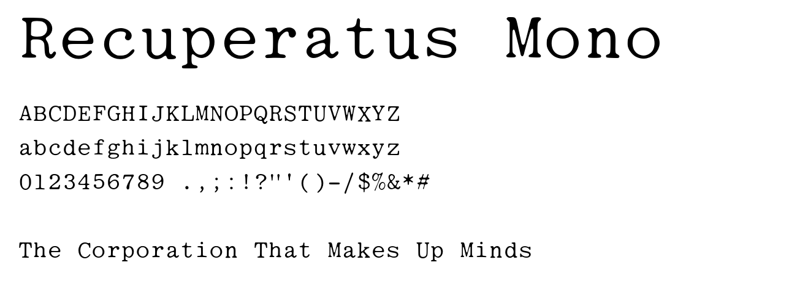

# Recuperatus

*Recuperatus*™ aspires to be a collection of typefaces recovered from
historical documents: struck, printed or typed letterforms brought
back as modern, freely licensed fonts.

At present, however, it is one font.

## Recuperatus Mono

A monospaced typewriter face (10 characters per inch, 600/1000 em advance)
recovered from the typescript of *The Reign of ETS: The Corporation That Makes
Up Minds*, the Ralph Nader report on the Educational Testing Service (Allan
Nairn and Associates, 1980).

We first took it for Courier, but set on a page it is a good deal prettier,
and it is clearly its own design. The easiest way to tell them apart is to compare
the `a`, `g`, `&` and `%`. Courier's `g` is open, and its tail curls down on the
right like handwriting; here the `g` comes down on the left and closes in a loop.
The `&` is closed, the `%` joins its upper circle to the slash, the `#` has a
very distinct style, and the `9` has an interesting shape of its own. The
serifs are clearly shaped rather than Courier's straight slabs. These are
features of the typeface, not ink spread from averaging many impressions.
We haven't identified the face; if you know it, please open an issue.

Each glyph was rebuilt statistically rather than drawn: the page images were
OCR'd, every character was located on the typewriter's fixed-pitch grid, and up
to 600 impressions of each character from across the report were registered to
sub-pixel accuracy and median-combined at 4x resolution. The median averages
away ink spread, paper grain and ribbon wear that no single impression is free
of; the result was traced to outlines and cleaned up in FontForge.

- `fonts/recuperatus-mono/RecuperatusMono-Regular.otf` — CFF outlines
- `fonts/recuperatus-mono/RecuperatusMono-Regular.ttf` — TrueType, hinted with ttfautohint
- 81 glyphs: Basic Latin letters, digits and the punctuation that appears in
  the source. As on many typewriters, the digit `1` and lowercase `l` share a
  shape.

## Tools

[`tools/`](tools/) contains the pipeline used to build the font from a
directory of page images (`pages/NNNN.png`):

| step | script | |
|---|---|---|
| 1 | `01_ocr_chars.sh` | per-character OCR boxes (tesseract hOCR) |
| 2 | `02_grid.py` | fit each line's fixed-pitch grid; assign characters to columns |
| 3 | `03_masters.py` | register and median-combine instances into high-resolution glyph masters |
| 4 | `04_font.py` | trace masters (potrace) and build a monospaced OTF (fontTools) |
| 5 | `06_font_finish.py` | FontForge cleanup, OTF + hinted TTF export |

Requirements: `tesseract`, `potrace`, `ttfautohint` (system packages) and
`numpy scipy scikit-image pillow fonttools skia-pathops fontforge` (pip; until
FontForge's next release, `pip install git+https://github.com/fontforge/fontforge`).
Set `FAMILY="Recuperatus <Name>"` when building a new face. Pitch and resolution
constants are tuned for 10 cpi typescript imaged at about 180 ppi; adjust
`PITCH` in `03_masters.py` for other sources.

For a face with few impressions (a short passage in a second typewriter),
lower `MIN_SAMPLES` to keep rare glyphs; glyphs built from fewer than three
impressions are clipped to their own cell so a neighbour's ink isn't traced
into them. `EXTRA_SKIP` lists characters to leave out (e.g. OCR misreads that
produced a spurious master).

## Contributing

New fonts are welcome. A contribution should:

- be recovered from a historical source (typescript, print, signage, ...) rather
  than drawn freehand or copied from an existing font program;
- be named **Recuperatus *Something*** and live in `fonts/recuperatus-something/`;
- be offered under the same dual license (OFL-1.1 with Reserved Font Name
  "Recuperatus", or AGPL-3.0-or-later), with your own copyright line;
- include a short note on its source and how it was recovered.

Open an issue or pull request.

## License

Dual-licensed under the SIL Open Font License 1.1 or the GNU Affero General
Public License v3 or later; see [LICENSE.md](LICENSE.md), but TL;DR:

- If you don't know, you probably want to use this under the SIL Open
  Font License 1.1, which is the standard open font license.
- If you need AGPL-compatibility in a combined work, or want a
  recognized open-source software license for other reasons, use AGPL.

---

Recuperatus is a trademark of Piotr Mitros.
